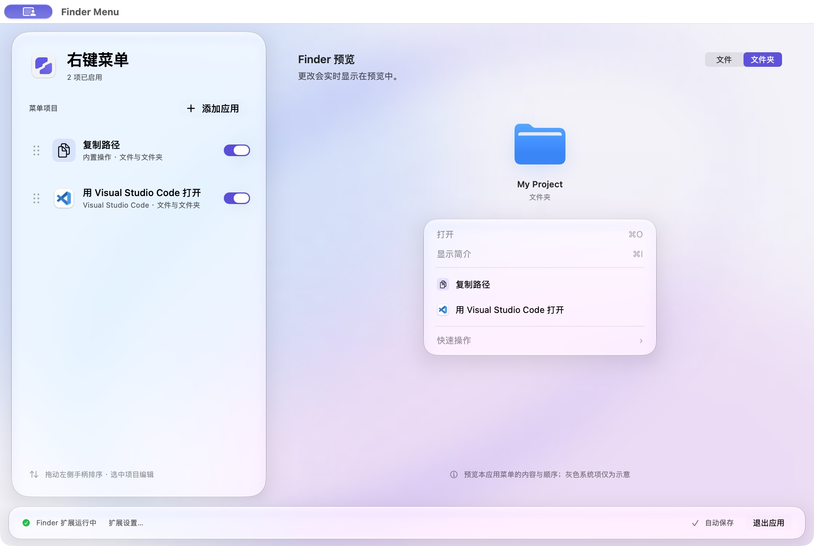
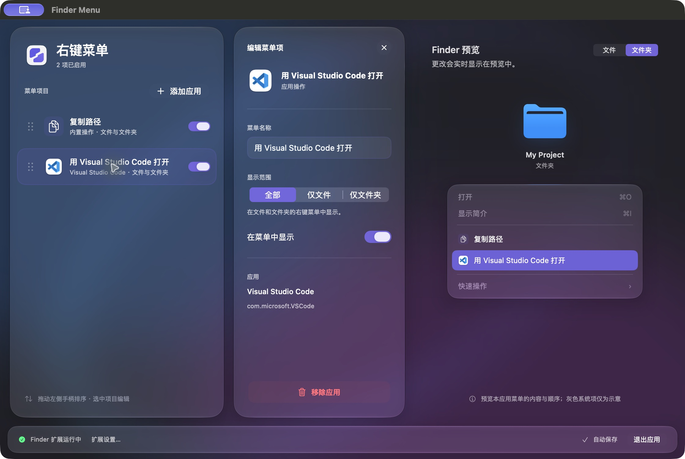

<h1 align="center">Finder Menu</h1>

<strong>让 Finder 右键菜单，更顺手。</strong>

把常用应用和复制路径放进右键菜单，少一次拖拽，少一次切换。

  <a href="https://github.com/jo-hnny/finder-menu/releases/latest"><strong>下载 Mac 版</strong></a>
  &nbsp; · &nbsp;
  <a href="#开始使用">开始使用</a>

当前开发版实机预览 · macOS 27 · 浅色外观。已发布版本的界面可能有所不同。

## 常用操作，右键就到

选中文件或文件夹，直接用你指定的应用打开；需要分享位置或粘贴到终端时，一键复制路径。你决定菜单里留下什么，以及它们出现的顺序。

- **把常用应用放进来。** 选择一个或多个应用，就能为它们添加打开入口，显示熟悉的应用图标。
- **只在需要时出现。** 为每个操作选择「仅文件」「仅文件夹」或「全部」，让文件和文件夹各有合适的菜单。
- **按你的习惯排列。** 拖动排序、修改名称，暂时不用的操作可以随手关闭。
- **改完就能看见。** 切换文件与文件夹预览，检查菜单的内容和顺序；修改自动保存。

## 一边整理，一边预览

左侧固定显示菜单项目，选中即可编辑。宽窗口把列表、编辑和预览并排展开；小窗口在编辑与预览之间切换，保持你设定的窗口大小。

当前开发版实机预览 · 深色外观 · 选中菜单项时同步高亮预览。

界面跟随系统的浅色与深色外观。macOS 26 及更新版本使用 Liquid Glass，较早版本使用系统材质，并支持「减少动态效果」和「降低透明度」。界面提供简体中文与英文。

设置完成后，可以直接退出配置窗口。Finder 菜单仍然可用，无需一直开着应用。

## 开始使用

适用于 **Apple Silicon Mac，macOS 14 或更新版本**。当前提供的安装包不支持 Intel Mac。

1. 从 [Releases 下载 DMG 安装包](https://github.com/jo-hnny/finder-menu/releases/latest)，打开后将 **Finder Menu** 拖入 **Applications（应用程序）**。
2. 启动 Finder Menu，点击底部的 **「扩展设置…」**，在系统设置中启用 Finder Menu 扩展。
3. 点击 **「添加应用」**，选好常用应用，再回到 Finder 中右键文件或文件夹试试。

当前安装包尚未经过 Apple 公证，首次打开可能遇到 macOS 安全提示。

后续可在应用菜单中选择 **「检查更新…」**。安装或升级后，请先启动一次 Finder Menu，再使用「用 … 打开」。

## 你可能想知道

**添加应用后，任何文件都能打开吗？**

能处理哪些文件或文件夹，取决于所选应用本身。可以按实际用途设置显示范围，例如只在文件夹菜单中显示代码编辑器。

**能调整 Finder 自带菜单的顺序吗？**

Finder Menu 管理自己添加的操作，不改变 Finder 的系统菜单。窗口中灰色的系统菜单项仅用于示意。

**需要停用时怎么做？**

关闭列表中的开关即可隐藏单个操作；要停用整个工具，在系统设置中关闭 Finder Menu 扩展。

---

[下载 Finder Menu](https://github.com/jo-hnny/finder-menu/releases/latest) · [反馈问题](https://github.com/jo-hnny/finder-menu/issues) · [开发指南](docs/DEVELOPMENT.md)
