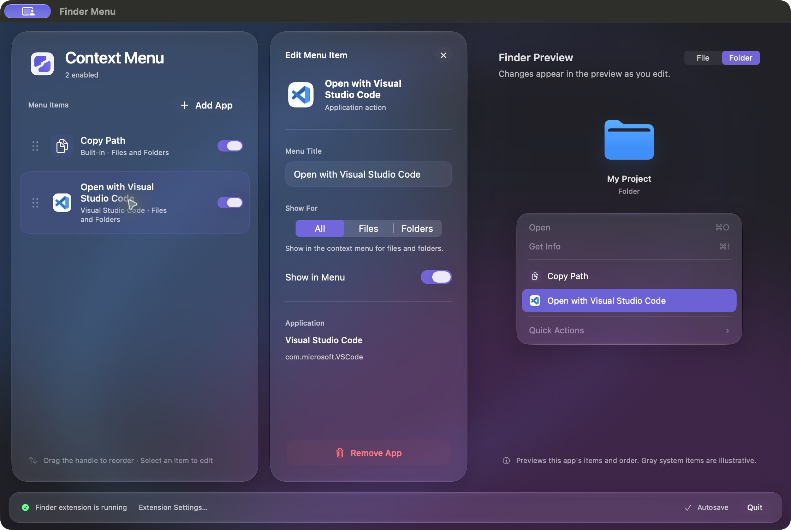

  <a href="README.md">English</a> · <a href="README.zh-CN.md">简体中文</a>

<h1 align="center">Finder Menu</h1>

<strong>Your favorite apps, one right-click away.</strong>

A macOS Finder context menu utility. Add your favorite apps, copy paths, and spend less time dragging files between windows.

  <a href="https://github.com/jo-hnny/finder-menu/releases/latest"><strong>Download for Mac</strong></a>
  &nbsp; · &nbsp;
  <a href="#get-started">Get started</a>

macOS 27 · Light appearance. The interface may vary slightly across macOS versions.

## Everyday actions, a right-click away

Select a file or folder and open it directly in an app you choose. Copy its path when you need to share a location or paste it into a terminal. You decide which actions appear and in what order.

- **Add the apps you use.** Choose one or more applications to create menu entries with their familiar icons.
- **Show actions where they belong.** Set each action to appear for files, folders, or both.
- **Make the menu yours.** Drag to reorder, rename entries, and switch off actions you do not need right now.
- **See changes as you go.** Preview file and folder menus to check their contents and order. Changes save automatically.

## Organize and preview side by side

Your menu list stays visible on the left. Select an entry to edit it. Wide windows show the list, editor, and preview together; smaller windows switch between editing and previewing without changing the window size you chose.

macOS 27 · Dark appearance · The selected action is highlighted in the preview.

Finder Menu follows your system's light or dark appearance. It uses Liquid Glass on macOS 26 and later, with system materials on earlier versions, and respects Reduce Motion and Reduce Transparency. The app is available in **English and Simplified Chinese**.

Once your menu is set up, you can quit the configuration app. Your Finder actions remain available.

## Get started

Requires an **Apple Silicon Mac running macOS 14 or later**. Current release packages do not support Intel Macs.

1. [Download the DMG from Releases](https://github.com/jo-hnny/finder-menu/releases/latest), open it, and drag **Finder Menu** into **Applications**.
2. Launch Finder Menu, click **Extension Settings…** at the bottom, and enable the Finder Menu extension in System Settings.
3. Click **Add App**, choose your favorite applications, then right-click a file or folder in Finder to try them out.

Current release packages are not notarized by Apple. macOS may display a security warning the first time you open the app.

For future updates, choose **Check for Updates…** from the app menu. After installing or upgrading, launch Finder Menu once before using an “Open with…” action.

## A few useful details

**Can an added app open every file?**

Supported files and folders depend on the application itself. Set the display scope to match how you use it—for example, show your code editor only in folder menus.

**Can I reorder Finder's built-in menu items?**

Finder Menu manages the actions it adds; it does not change Finder's system menu. Gray system entries in the preview are illustrative.

**How do I turn it off?**

Use an entry's switch to hide an individual action. To disable the entire tool, turn off the Finder Menu extension in System Settings.

---

[Download Finder Menu](https://github.com/jo-hnny/finder-menu/releases/latest) · [Report an issue](https://github.com/jo-hnny/finder-menu/issues) · [Developer guide (中文)](docs/DEVELOPMENT.md)
